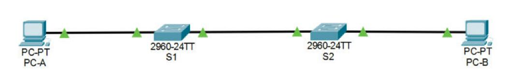

# VLAN et trunk 802.1Q – Cisco Packet Tracer

TP réalisé à l'ESAIP (ING2) : création de VLAN sur deux switchs Cisco 2960, liaison trunk 802.1Q avec VLAN natif dédié, VLAN de management et sécurisation de base des équipements.


## Topologie

### Capture Packet Tracer



### Schéma logique


## VLAN

| ID | Nom | Rôle |
|---|---|---|
| 10 | Operations | Utilisateurs (PC-A, PC-B) |
| 20 | Parking_Lot | VLAN « parking » pour ports non utilisés |
| 99 | Management | Administration des switchs |
| 1000 | Native | VLAN natif du trunk (distinct du VLAN 1) |

## Adressage de management

| Switch | Interface | Adresse IP |
|---|---|---|
| S1 | VLAN 99 | 192.168.1.11 /24 |
| S2 | VLAN 99 | 192.168.1.12 /24 |

## Configuration notable

```cisco
interface FastEthernet0/1
 switchport mode trunk
 switchport trunk native vlan 1000
!
interface FastEthernet0/6
 switchport mode access
 switchport access vlan 10
!
interface Vlan99
 ip address 192.168.1.11 255.255.255.0
```

**Sécurisation de base** : `enable secret`, mots de passe console/VTY, `service password-encryption`, bannière MOTD, `no ip domain-lookup`.

Toutes les configurations sont regroupées dans [`CONFIGURATIONS.md`](CONFIGURATIONS.md).

## Compétences mises en œuvre

- Création et nommage de VLAN, affectation des ports en mode access
- Trunk 802.1Q et changement du VLAN natif (bonne pratique contre le VLAN hopping)
- Interface virtuelle (SVI) de management
- Sécurisation de l'accès aux équipements

## Utilisation

Ouvrir [`tp-vlan.pkt`](tp-vlan.pkt) avec **Cisco Packet Tracer 8.2** ou plus récent, puis vérifier avec `show vlan brief`, `show interfaces trunk` et un `ping` entre PC-A et PC-B.

## Contenu du dossier

| Élément | Description |
|---|---|
| [`tp-vlan.pkt`](tp-vlan.pkt) | Fichier Cisco Packet Tracer du projet |
| [`CONFIGURATIONS.md`](CONFIGURATIONS.md) | Configuration de chaque équipement et adressage des postes, en un seul fichier |
| [`configs/`](configs/) | Une configuration brute par équipement (`.txt`) |
| [`images/`](images/) | Captures de la topologie |

## Auteur

**Anatole BERNARD** – étudiant ingénieur à l'ESAIP
